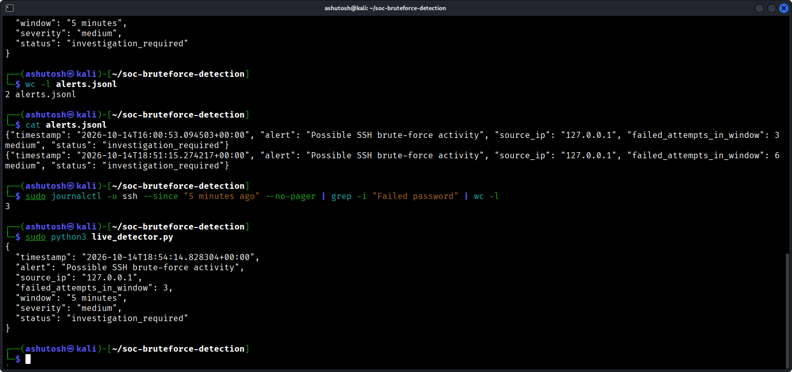

# SSH Brute-Force Detection Using Python

## Project Overview
A lightweight Python-based security monitoring project that detects potential SSH brute-force activity by analyzing authentication logs on Kali Linux. The detector counts failed SSH login attempts by source IP and generates structured JSON alerts when a configurable threshold is reached.

## Objectives
- Analyze SSH authentication logs.
- Identify repeated failed login attempts.
- Generate structured security alerts in JSON format.
- Store alerts for investigation and reporting.
- Validate detection logic using automated unit tests.

## Tools and Technologies
- Kali Linux
- Python 3
- OpenSSH
- `journalctl`
- JSON / JSONL
- Git and GitHub
- Python `unittest`

## Detection Workflow
1. Retrieve recent SSH service logs using `journalctl`.
2. Parse failed authentication events and extract source IP addresses.
3. Count failed attempts within the configured five-minute window.
4. Trigger an alert when an IP reaches the threshold of three failed attempts.
5. Save the alert to a JSON Lines file for investigation.

## Detection Configuration
| Setting | Value |
|---|---|
| Log source | SSH service logs |
| Monitoring window | 5 minutes |
| Alert threshold | 3 or more failed attempts |
| Severity | Medium |
| Alert status | Investigation required |

## Project Files
- `live_detector.py` — analyzes recent SSH service logs and generates alerts.
- `detection_rules.py` — applies the failed-login threshold.
- `log_parser.py` — extracts source IPs from failed SSH login events.
- `alert_writer.py` — creates and saves structured alerts.
- `detect_bruteforce.py` — analyzes sample authentication logs.
- `detect_bruteforce_v2.py` — provides an additional sample-log detection implementation.
- `monitor.sh` — runs the detector periodically.
- `sample_auth.log` — sample authentication events.
- `test_*.py` — automated tests for detection, parsing, and alert generation.
- `alerts.jsonl` — runtime alert output; generated locally.

## Setup and Usage

### 1. Install and start SSH
```bash
sudo apt update
sudo apt install openssh-server -y
sudo systemctl enable --now ssh
```

### 2. Run the live detector
```bash
cd ~/soc-bruteforce-detection
sudo python3 live_detector.py
```

### 3. View generated alerts
```bash
cat alerts.jsonl
```

### 4. Run automated tests
```bash
python3 -m unittest -v
```

### 5. Run continuous monitoring
```bash
./monitor.sh
```

## Sample Alert
```json
{
  "timestamp": "example timestamp",
  "alert": "Possible SSH brute-force activity",
  "source_ip": "127.0.0.1",
  "failed_attempts_in_window": 3,
  "window": "5 minutes",
  "severity": "medium",
  "status": "investigation_required"
}
```

The timestamp above is illustrative. Actual alerts include a generated UTC timestamp.

## Testing
The project has 12 automated unit tests covering:
- Failed-login threshold detection.
- SSH log parsing.
- End-to-end detection pipeline behavior.
- JSON alert generation and appending.

The live detector was also tested using repeated failed SSH login attempts in a local lab.

## Security Notes
Testing was performed in a local lab. The IP address `127.0.0.1` is the loopback address of the local machine, not an external attacker.

## Limitations
- This is a lightweight detection prototype, not a full SIEM.
- Detection requires SSH service logs to be available through `journalctl`.
- Alert deduplication is basic and may need improvement.
- Behavior may differ across Linux distributions and logging configurations.

## Future Improvements
- Improve alert deduplication and incident tracking.
- Add configurable thresholds and monitoring windows.
- Add more detection scenarios and test cases.
- Integrate with a SIEM platform such as Wazuh.
- Add verified screenshots and investigation documentation.

## Detection Evidence

### SSH Brute-Force Detection Alert

The detector identifies repeated failed SSH login attempts and generates a structured security alert.


### Saved Security Alerts

Generated alerts are stored in JSON Lines format for later review and investigation.



## Disclaimer
For educational purposes and authorized lab testing only.
