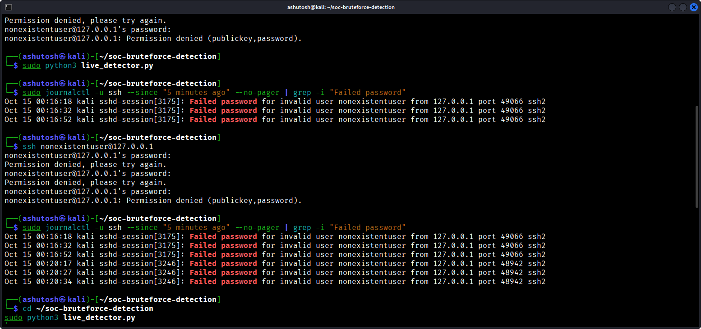

# SSH Brute-Force Detection Using Python

## Project Overview
This project detects potential SSH brute-force activity by analyzing authentication logs on Kali Linux. It counts failed login attempts by source IP and generates an alert when an IP reaches the configured threshold.

## Objectives
- Monitor SSH authentication logs.
- Detect repeated failed login attempts.
- Generate structured JSON alerts.
- Save alerts for investigation and reporting.

## Tools and Technologies
- Kali Linux
- Python 3
- OpenSSH
- Linux `journalctl`
- JSON

## Detection Logic
- **Log source:** SSH service logs.
- **Monitoring window:** 5 minutes.
- **Alert threshold:** 3 or more failed SSH login attempts from the same IP.
- **Severity:** Medium.
- **Alert status:** Investigation required.

## Project Files
- `detect_bruteforce.py` — analyzes sample authentication logs.
- `detect_bruteforce_v2.py` — generates a JSON alert from sample logs.
- `live_detector.py` — analyzes recent SSH service logs.
- `monitor.sh` — runs the detector periodically.
- `sample_auth.log` — sample failed-login events.
- `alerts.jsonl` — stores generated alerts.

## Setup and Usage

### 1. Install and start SSH
```bash
sudo apt update
sudo apt install openssh-server -y
sudo systemctl enable --now ssh
```

### 2. Run the live detector
```bash
cd ~/soc-bruteforce-detection
sudo python3 live_detector.py
```

### 3. View saved alerts
```bash
cat alerts.jsonl
```

### 4. Run continuous monitoring
```bash
./monitor.sh
```
## Detection Evidence

The screenshot below shows the detector identifying repeated SSH authentication failures and generating a security alert.



## Sample Alert
```json
{
  "alert": "Possible SSH brute-force activity",
  "source_ip": "127.0.0.1",
  "failed_attempts_in_window": 3,
  "window": "5 minutes",
  "severity": "medium",
  "status": "investigation_required"
}
```

## Security Notes
Testing was performed in a local lab using failed SSH login attempts. The loopback address `127.0.0.1` represents the local machine, not an external attacker.

## Limitations
- This is a lightweight Python log-detection prototype, not a full SIEM deployment.
- Detection depends on SSH logs being available through `journalctl`.
- The threshold is configurable and may need tuning.
- Further testing is needed for different Linux distributions and logging configurations.

## Future Improvements
- Add configurable thresholds and time windows.
- Improve alert deduplication and incident tracking.
- Add automated tests and detection metrics.
- Integrate with a SIEM platform such as Wazuh.

## Disclaimer
For educational purposes and authorized lab testing only.
